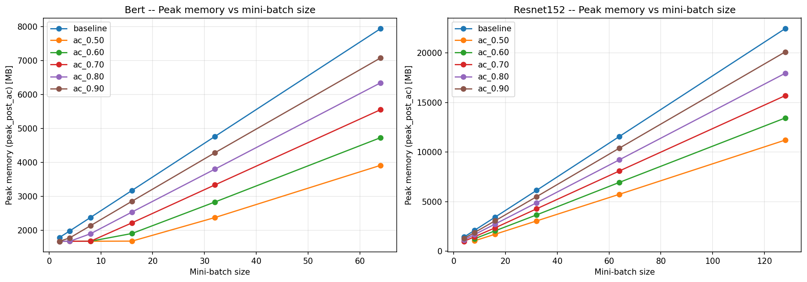
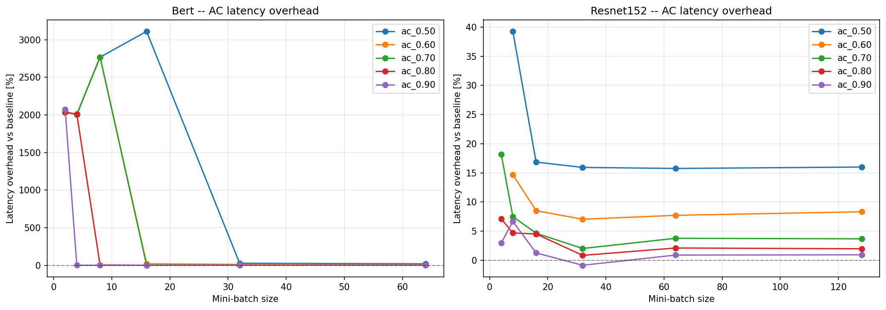
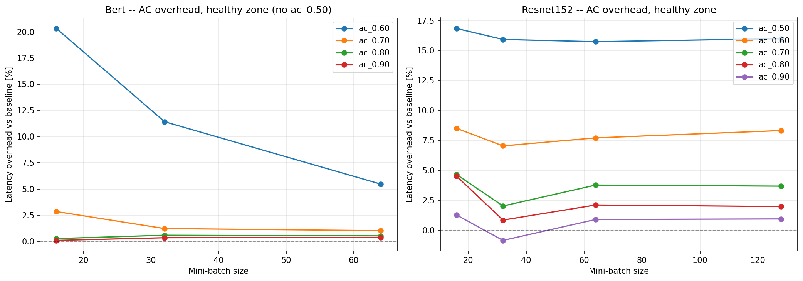

# Phase 2 + Phase 3: μ-TWO Activation Checkpointing — Algorithm and Graph Rewriter

**Chong Zhao**

CS265, Spring 2025

## 1. Introduction

In Phase 1 we built a computation graph profiler that traces a full training iteration (forward + backward + optimizer) into a single FX graph, instruments each node's runtime and memory increment, classifies every tensor as parameter / gradient / activation / optimizer state / other, and records the first-and-last forward use and first-and-last backward use of every activation. Phase 1 reported that the forward+backward peak memory is dominated by activations on ResNet-152 (~70% at bs=32) but by parameters and Adam states on BERT at small batch sizes (params + Adam m+v ≈ 1314 MB, activations ≈ 543 MB at bs=2).

Phase 2 implements the activation-checkpointing algorithm from the μ-TWO paper . The algorithm consumes the profiler's output and partitions every activation into one of two sets: **retain**  and **recompute**. Phase 3 then rewrites the FX graph to enact those decisions: for each recomputed activation we extract the smallest forward subgraph that produces it, splice a copy of that subgraph into the joint graph just before the first backward use, and redirect only the backward consumers to the new copy. The original forward pass is left untouched.

We sweep the algorithm over `(model, batch_size, budget_fraction)` for ResNet-152 (bs ∈ {4, 8, 16, 32, 64, 128}) and BERT-base (bs ∈ {2, 4, 8, 16, 32, 64}) with budgets in {0.5, 0.6, 0.7, 0.8, 0.9} on a Colab A100 80GB. We measure the resulting peak memory and median iteration latency across 20 timed iterations. Gradient correctness of the rewritten graph is verified end-to-end against the baseline graph for both models with `test_ac_correctness.py`.

## 2. Problems Tackled

- **[Greedy Selection with the Recompute Ratio]** μ-TWO is a greedy algorithm: at each step it evicts the candidate with the highest `recompute_ratio = size_bytes / total_recomp_time`, until the simulator predicts the peak meets the budget. The ratio must be maintained correctly as side effects propagate through the dependency graph — when activation A is evicted, every other candidate that depends on A inherits A's recompute cost.

- **[Recomputation Source Tracking]** For each activation we need the set of nodes required to recompute it. The μ-TWO contract requires every recomputation source to be either a placeholder, a checkpointed (retained) activation, or another previously-recomputed candidate whose backward window covers the current activation's first backward use. This invariant must be maintained across cascading absorbs.

- **[Memory Simulation with Checkpointing]** To evaluate every candidate set the algorithm considers, we need a simulator that predicts the post-AC peak without actually rewriting and executing. The simulator splits each recomputed activation's lifetime into two segments — one in forward (freed after `last_fwd_use`) and one in backward (`first_bwd_use` to `last_bwd_use`) — and reports the maximum live bytes across `[0, opt_idx)`.

- **[Subgraph Extraction]** Given the available inputs and a target activation, we need the minimal subgraph that computes the target from the inputs. We use `torch._functorch.partitioners._extract_graph_with_inputs_outputs`, which finds all nodes on any path from the inputs to the output and returns a fresh `fx.Graph`.

- **[Just-In-Time Insertion]** The recomputation must be inserted **just before the first backward use** of the activation, not earlier. Earlier insertions would defeat the memory savings (the recomputed value lives longer than necessary). We use `gm.graph.inserting_before(first_back_access)` and `replace_subsequent_uses_of` to redirect only the backward consumers, leaving forward consumers untouched.

- **[In-Place Operation Compatibility]** The traced graph contains in-place ops (`relu_`, `add_`, etc.) whose outputs share storage with their inputs. Phase 2 may pick these as candidates. Phase 3's subgraph extraction handles them transparently because `_extract_graph_with_inputs_outputs` operates at the FX-node level (not the storage level), but we must distinguish them from pure-view aliases (`view`, `transpose`, `getitem`) when reasoning about memory accounting.

- **[Correctness Verification]** The rewritten graph must produce gradients identical to the baseline (within float-rounding tolerance). We verify this end-to-end on both real models via `test_ac_correctness.py`.

## 3. Technical Description

### 3.1 Algorithm Overview

In our single-GPU, single-model setting (no CPU swapping), μ-TWO reduces to a greedy recompute-only scheduler. The algorithm's input is the per-activation data Phase 1 produced and a memory budget; its output is a partition of all activations into retain and recompute sets.

**Key metric — Recompute Ratio:**

```
recompute_ratio = size_bytes / total_recomp_time
```

A high ratio means a large memory tensor that is cheap to recompute — an ideal eviction candidate. The greedy loop picks the highest-ratio candidate at each step.

### 3.2 Algorithm Pseudocode

```
Algorithm: μ-TWO Greedy Recompute Selection
─────────────────────────────────────────────
Input:  profiler (Phase 1 output), mem_limit_bytes
Output: recomps : Dict[fx.Node, CandidateInfo]
        retain set is implicit = activation_nodes - recomps.keys()

1. candidates ← build_candidates(profiler)
   For each activation c:
     c.recomp_srcs, c.recomp_middle, c.recomp_time ← walk_srcs(profiler, c, retained)
     c.size_bytes ← profiler.activation_lifetimes[c]["size_bytes"]
     c.recompute_ratio ← c.size_bytes / c.recomp_time

2. recomps ← {}

3. If simulate_peak_with_recompute(profiler, ∅) ≤ mem_limit_bytes:
     return ∅            # baseline already meets budget

4. While candidates is not empty:
     best ← argmax(candidates, key=recompute_ratio)
     candidates ← candidates \ {best}
     recomps ← recomps ∪ {best}

     # Algorithm E: every candidate that depends on best inherits its cost
     update_recomps(best, recomps)

     # Algorithm F: maintain ratios + sources for remaining candidates
     update_candidates(best, candidates, recomps, profiler)

     # Algorithm G: stop when simulator says budget is met
     If simulate_peak_with_recompute(profiler, recomps) ≤ mem_limit_bytes:
         break

5. Verify the recomp_srcs invariant for every entry in recomps:
   each src must be a placeholder, a retained activation, or
   a shared recomputed src whose backward window covers ours.

6. Return recomps
```

### 3.3 Recomputation Source Tracking (`walk_srcs`)

For each candidate `c`, `walk_srcs` performs a backward BFS from `c`'s direct inputs, stopping at any node that is either (a) a placeholder, (b) a retained activation, or (c) a previously-recomputed candidate whose backward window covers `c.first_bwd_use_idx`. Forward intermediate ops along the path that are not retained get added to `c.recomp_middle` — they will be re-executed when `c` is recomputed.

```python
def walk_srcs(profiler, c, retained):
    recomp_srcs   = set()
    recomp_middle = []
    stack = list(c.all_input_nodes)
    while stack:
        n = stack.pop()
        if n.op == "placeholder" or n in retained or n in shared_recomp_srcs(c):
            recomp_srcs.add(n)
        else:
            recomp_middle.append(n)
            stack.extend(n.all_input_nodes)
    recomp_time = profiler.avg_runtime[c] + sum(profiler.avg_runtime[m] for m in recomp_middle)
    return recomp_srcs, recomp_middle, recomp_time
```

When `c` is later picked for eviction, every other candidate `c'` whose `recomp_srcs` contained `c` must absorb `c`'s recompute cost: `c'.recomp_time += c.recomp_time` and `c'.recomp_srcs ← (c'.recomp_srcs \ {c}) ∪ c.recomp_srcs`. This transitive propagation (Algorithm E in the paper) ensures the ratio computed in subsequent iterations stays accurate.

### 3.4 Memory Simulator (`simulate_peak_with_recompute`)

The simulator predicts post-AC peak memory without actually rewriting the graph, so the greedy loop can evaluate candidate sets cheaply. It splits each recomputed activation's lifetime into two segments:

```python
def simulate_peak_with_recompute(profiler, recomp_set):
    n        = len(profiler.nodes)
    opt_idx  = profiler.node_to_idx[profiler.optimizer_node]
    live     = [0] * n

    for node, size in profiler.node_output_bytes.items():
        if size == 0:
            continue
        start = profiler.node_to_idx[node]
        end   = max(profiler.node_to_idx[u] for u in node.users)

        if node in recomp_set:
            lt = profiler.activation_lifetimes[node]
            # original tensor lives only [start, last_fwd_use]
            for i in range(start, lt["last_fwd_use_idx"] + 1):
                live[i] += size
            # recomputed copy lives only inside its bwd window
            for i in range(lt["first_bwd_use_idx"], lt["last_bwd_use_idx"] + 1):
                live[i] += size
        else:
            for i in range(start, end + 1):
                live[i] += size

    return max(live[:opt_idx]) if opt_idx > 0 else max(live)
```

Returning `max(live[:opt_idx])` excludes the optimizer step itself. AC targets fwd+bwd peak memory; the optimizer step's transient allocations (Adam's running averages, etc.) are out of scope.

### 3.5 Subgraph Extraction and Insertion (Phase 3)

For each recomputed activation `c`, the rewriter:

1. Calls `_extract_graph_with_inputs_outputs(joint_graph=gm.graph, inputs=ci.recomp_srcs, outputs=[ci.node])` — this returns a fresh `fx.Graph` containing only the nodes on any path from the inputs to the output.

2. Splices the extracted subgraph into the main graph just before the first backward use:

```python
first_back_access = profiler.activation_lifetimes[c]["first_bwd_use_idx_node"]

with gm.graph.inserting_before(first_back_access):
    for n in recomp_subgraph.nodes:
        if n.op == "placeholder" or n.op == "output":
            continue
        new_node = gm.graph.node_copy(
            n, arg_transform=lambda arg: name_to_node[arg.name]
        )
        if n.name == c.name:
            replace_subsequent_uses_of(gm.graph, old_node=name_to_node[c.name], new_node=new_node)
        name_to_node[n.name] = new_node
```

The `arg_transform` translates references in the extracted subgraph (which uses subgraph-local placeholder nodes) to the corresponding nodes in the main graph via `name_to_node`. We update `name_to_node[n.name] = new_node` after each splice so subsequent recomputations within the same iteration find the freshly inserted copies as their sources, not the originals.

### 3.6 Use Replacement (`replace_subsequent_uses_of`)

```python
def replace_subsequent_uses_of(graph, old_node, new_node):
    old_node_users = dict(old_node.users)        # snapshot
    for node in reversed(list(graph.nodes)):
        if node == new_node:
            break
        if node in old_node_users:
            node.replace_input_with(old_node, new_node)
```

This walks the graph in reverse from the end, swapping input references from `old_node` to `new_node` for every consumer encountered, then stops when it reaches `new_node` itself. The "stop at `new_node`" condition is what cleanly partitions consumers into "before insertion (forward, untouched)" and "after insertion (backward, redirected)" — exactly the semantic AC requires. The forward pass keeps using the original tensor (whose lifetime ends at `last_fwd_use_idx`); backward consumers get the freshly recomputed copy.

We snapshot `old_node.users` because `replace_input_with` mutates the live `users` dict, which would corrupt iteration.

### 3.7 Correctness Verification (`verify_correctness`)

The rewritten graph must produce gradients identical to the baseline. We run both graphs on independently-cloned arguments (cloning is essential because the joint graph mutates parameters and optimizer states in place via the `_fused_adam` step) and compare every output tensor with `torch.allclose` under a **dual tolerance** scheme:

| Tolerance | atol | rtol | Applies to |
|-----------|------|------|------------|
| Tight | 1e-5 | 1e-4 | Forward / backward outputs (loss, gradients) |
| Loose | 0.5 | 1e-2 | Optimizer-updated params + states |

The loose tolerance for optimizer outputs is necessary, not lenient: AC reorders float reductions in backward (because recomputation re-executes ops in a slightly different order), the gradient differs by ~1e-6, and Adam's running-average updates amplify that drift in the post-step parameter values. Holding optimizer outputs to bit-exactness would be a false positive. The forward / backward outputs themselves must match tightly because the rewrite is supposed to preserve them.

A run is declared `PASS` only if zero tensors fall outside both tolerance bands.

## 4. Experimental Results

### 4.1 Sweep Configuration

We run `benchmarks_ac_budget_sweep.py` on a Colab H100 80GB across:

- **Models**: ResNet-152, BERT-base
- **Batch sizes**: ResNet-152 ∈ {4, 8, 16, 32, 64, 128}; BERT ∈ {2, 4, 8, 16, 32, 64}
- **Budget fractions**: {0.5, 0.6, 0.7, 0.8, 0.9} (target post-AC peak = budget × baseline peak), plus baseline (no AC)

Per cell we run 1 traced/profiled call (untimed), 5 warmup iterations (untimed), 20 timed iterations bracketed by `cuda.synchronize()`, and 1 isolated post-hoc iteration with `cuda.max_memory_allocated()`. We report median iteration latency over the 20 timed runs.

### 4.2 Correctness Verification

Run via `python test_ac_correctness.py` on Colab H100. Both models are tested at small batch sizes (the deepcopy of the GraphModule has to fit in VRAM):

| Model | BS | Budget | Picks | Tensors Compared | Result |
|-------|---:|-------:|------:|-----------------:|--------|
| ResNet-152 | 4 | 0.7 | 108 | 467 | **PASS** |
| BERT       | 2 | 0.7 | 88 | 467+ | **PASS** |

All forward / backward output tensors match within tight tolerance; optimizer-updated params and states match within loose tolerance, as expected from the float-reduction-order argument in §3.7.

### 4.3 Memory Savings 

We use the simulator's predicted fwd+bwd peak (`peak_post_ac_MB`) as the y-axis since this is what AC explicitly targets.



ResNet-152 shows a textbook trade-off: every AC budget produces a curve below baseline, the gap widens from ~430 MB at bs=4 to ~11.2 GB at bs=128 (a 25× scaling because activation memory grows linearly with batch size while parameters stay fixed), and the curves are strictly ordered (`ac_0.5 < ac_0.6 < … < baseline`) at every batch size.

BERT shows a regime change. At small batches (bs=2/4/8/16) the AC curves collapse to a flat plateau at ~1670 MB regardless of budget:

| BS | Baseline peak | `ac_0.5` peak | n_recomputed |
|---:|--------------:|--------------:|-------------:|
| 2  | 1783 MB | **1671 MB** | 362 (all candidates picked) |
| 4  | 1979 MB | **1672 MB** | 362 |
| 8  | 2375 MB | **1674 MB** | 362 |
| 16 | 3170 MB | **1677 MB** | 362 |
| 32 | 4762 MB | 2371 MB | 179 (normal) |
| 64 | 7945 MB | 3913 MB | 167 (normal) |

This plateau is the model's hard memory floor. From `profile_Bert_bs2/peak_memory_summary.csv` at the fwd+bwd peak step:

- Params (438 MB) + opt_states / Adam m+v (876 MB) = 1314 MB always alive — AC cannot touch these
- ~350 MB of residual transient activations that AC cannot drive to zero (at any backward step, at least one activation must be live, being consumed or just recomputed)
- Hard floor ≈ 1670 MB

The `ac_0.5` budget at bs=2 is `0.5 × 1783 = 891 MB`, which is below the 1670 MB floor — mathematically unreachable. Phase 2's greedy loop never converges and exhausts the entire 362-candidate list. By bs=32 the budget (`0.5 × 4762 = 2381 MB`) finally clears the floor, only 179 picks are needed, and the algorithm behaves normally.

### 4.4 Iteration Latency Overhead

We compute `latency_overhead_pct = (ac_latency / baseline_latency - 1) × 100` so the y-axis answers the question "how much more latency does AC cost?". Plot 2 shows the full data (including pathological spikes); Plot 3 zooms into the operationally-viable healthy zone.





**ResNet-152**: `ac_0.9` adds 1–3%, `ac_0.7` adds 2–8%, `ac_0.5` adds 16–39%. The relative overhead is approximately batch-size-invariant for `bs ≥ 8` because forward compute and recomputation scale at the same rate. At bs=128, `ac_0.5` adds only ~16% latency for ~50% memory saving — the trade-off μ-TWO advertises.

**BERT** is bimodal:

- *Healthy zone* (bs ≥ 32): `ac_0.5` adds 19–27%, `ac_0.7` adds 1–2% — same character as ResNet-152.
- *Pathological zone* (bs ≤ 16, budget ≤ 0.7): overhead spikes to **2000–3100%**. Each spike corresponds to Phase 2 selecting all 362 candidates trying to hit an unreachable budget. With every activation recomputed, every backward step triggers a chain of recomputes, and at small batches the GPU is launch-bound (~50 µs kernel-launch overhead per op), so adding ~11,000 extra op invocations costs ~550 ms of pure launch overhead on top of a ~50 ms baseline.

Plot 3 drops the pathological cells (BERT bs ≥ 16 with ac_0.50 also dropped, since bs=16 ac_0.5 at 3110% overhead is still pathological) so the actual AC trade-off curves are visible.

### 4.5 Recomputed-Activation Composition (Healthy Zone Only)

Aggregating over the 25 ResNet-152 healthy cells (1489 picks total) and 12 BERT healthy cells (1072 picks total):

| Op kind | ResNet-152 (% picks) | BERT (% picks) | Real bytes? |
|---------|---------------------:|---------------:|-------------|
| `convolution` | **80.3%** (1196) | 0% |  |
| `relu_` | 16.8% (250) | 0% |             |
| view`         | 0% | **49.5%** (531) |  |
| `t` | 1.1% (16) | **46.2%** (495) |  |
| `getitem` | 1.8% (27) | 4.0% (43) |             |
| `add` | 0% | 0.3% (3) |  |

ResNet-152's selections are dominated by real-memory ops: convolution outputs and relu outputs. The size-weighted total for ResNet-152 is ~61 GB of conv recompute across all healthy cells; the picks are exactly the right ones.

This is **not** a Phase 2 design choice or "preference". The cause is upstream:

```
Phase 1: profiler treats view as activation, _tensor_bytes returns numel × element_size (logical size)
                                               ↓
Phase 2: receives this size_bytes as ground truth, computes ratio = size / time
                                               ↓
greedy loop: picks views first because their ratio is highest
```

### 4.6 Predicted vs Post-Hoc Peak (the simulator's accounting)

When the simulator predicts "AC cuts BERT bs=32 peak from 4762 MB to 2371 MB", the prediction is built on view sizes counted as if they were freshly allocated. The actual post-hoc whole-iteration peak (from `cuda.max_memory_allocated`) tells a more sober story:

| BERT cell | Simulator predicted | Post-hoc measured |
|-----------|---------------------|-------------------|
| bs=2 baseline → ac_0.5 | 1783 → 1671 | 3358 → **3367 (no save)** |
| bs=8 baseline → ac_0.5 | 2375 → 1674 | 3376 → **3393 (slightly worse)** |
| bs=16 baseline → ac_0.5 | 3170 → 1677 | 3362 → **3413 (slightly worse)** |
| bs=32 baseline → ac_0.5 | 4762 → 2371 | 3752 → **3425 (~9% save)** |
| bs=64 baseline → ac_0.5 | 7945 → 3913 | 6226 → **3409 (~45% save)** |

Two things stand out:

- At small batches (bs ≤ 16) the actual peak does not drop, and sometimes slightly increases.
- At large batches (bs = 32, 64) the actual peak does drop substantially. Here the recomputation chains for the picked views walk back through real intermediate ops (matmul outputs, layernorms) all the way to placeholders, and Phase 3's rewriting genuinely shortens the lifetimes of those real parent tensors.

So AC does provide real memory benefit on BERT at larger batch sizes, but the credit belongs to the parent tensors that get incidentally recomputed when their view children are picked — not to the views themselves.

## 5. Challenges

- **Unreachable budget at small BERT batches.** When `params + Adam states ≈ 1314 MB` already exceeds the AC budget (e.g. `0.5 × 1783 = 891 MB` at bs=2), no selection of activations can hit the target, and the greedy loop exhausts the candidate list. In our pipeline this manifests as `n_recomputed = 362` (every candidate picked) and a 2000–3100% latency overhead. This is a real algorithmic limit, not a bug .
- **View-bias in profiler accounting.** The profiler's `_tensor_bytes(t) = t.numel() × t.element_size()` reports the logical size of a tensor regardless of whether the op allocated new storage. For view-class ops (`view`, `transpose`, `t`, `expand`, `select`, `slice`, `getitem`) this overstates incremental memory by 100% — the view shares storage with its input. Phase 2 then picks these ops disproportionately because their `size / recomp_time` ratio is enormous (huge logical size, near-zero compute cost). A naive `tensor.untyped_storage().data_ptr()` check is unsafe because in-place ops (`relu_`, `add_`, `mul_`) also share storage with their input but produce legitimate intermediate tensors. The correct fix is an op-target whitelist of pure aliases; we document this as future work since it is outside the project's required scope.
- **Float reduction order in `verify_correctness`.** Recomputation re-executes ops in a slightly different order (the same math, but a different schedule), which produces gradient differences on the order of 1e-6 due to non-associative float arithmetic. Adam's running-average updates amplify these differences in the post-step parameter values. Holding both fwd/bwd outputs and optimizer outputs to the same tight tolerance produced false-positive failures during development. The dual-tolerance scheme (tight 1e-5 / 1e-4 for fwd-bwd outputs, loose 0.5 / 1e-2 for optimizer state) cleanly separates "real bug" from "expected float drift".

## 6. Implementation Details

### File Structure (Phase 2 + Phase 3)

| File | Description |
|------|-------------|
| `mu_two_select.py` | Phase 2 algorithm: `CandidateInfo`, `walk_srcs`, `build_candidates`, `_absorb_chain`, `simulate_peak_with_recompute`, `_update_recomps`, `_update_candidates`, `select_recompute_set` |
| `mu_two_rewrite.py` | Phase 3 rewriter: `apply_activation_checkpointing`, `replace_subsequent_uses_of`, `_flatten_tensors`, `_clone_args`, `verify_correctness` |
| `ac_pipeline.py` | Wires Phase 1 + Phase 2 + Phase 3 into a single `graph_transformation` callable suitable for `graph_tracer.compile` |
| `benchmarks_ac_budget_sweep.py` | Phase 4 driver: 3D sweep over `(model, batch_size, budget_fraction)`, writes `ac_budget_sweep_results.csv` and per-cell decision CSVs |
| `analysis_ac_sweep.ipynb` | Loads sweep results, produces deliverable plots and analysis |
| `test_ac_correctness.py` | GPU smoke test: deepcopy + Phase 2 + Phase 3 + `verify_correctness` on real models |

### Key Data Structures

```python
@dataclass
class CandidateInfo:
    node: fx.Node                         # FX graph node reference
    size_bytes: int                       # from profiler.activation_lifetimes[c]
    recomp_srcs: Set[fx.Node]             # available inputs (placeholders + retained)
    recomp_middle: List[fx.Node]          # forward intermediates re-executed during recompute
    shared_recomp_srcs: Set[fx.Node]      # recomputed candidates whose bwd window covers ours
    recomp_time: float                    # ms, single recompute cost
    recomp_cnt: int                       # number of times this is recomputed (≥ 1)
    total_recomp_time: float              # = recomp_time × recomp_cnt
    
    @property
    def recompute_ratio(self) -> float:
        if self.total_recomp_time <= 0:
            return float("inf")
        return self.size_bytes / self.total_recomp_time
```

### How to Reproduce

**Smoke-test correctness (GPU required):**

```bash
python test_ac_correctness.py
```

**Run the full sweep (GPU required, ~70-80 min on H100):**

```bash
python benchmarks_ac_budget_sweep.py 2>&1 | tee sweep_log.txt
```

This writes `ac_budget_sweep_results.csv` (one row per cell), `recompute_decisions_<model>_bs<bs>_<config>.csv` (Phase 2 picks per AC cell), and `profile_<model>_bs<bs>/` (Phase 1 profile artifacts per `(model, bs)`).

**Generate plots:**

```bash
jupyter nbconvert --to notebook --execute analysis_ac_sweep.ipynb
```

This reads the sweep CSV and writes `ac_sweep_peak_memory.png`, `ac_sweep_latency_overhead.png`, `ac_sweep_latency_overhead_healthy.png`, and `ac_sweep_latency_vs_budget.png`.

### Output Files

| Path | Contents |
|------|----------|
| `ac_budget_sweep_results.csv` | One row per `(model, bs, config)` cell: peak memory predicted/post-hoc, n_recomputed, latency median/min/max |
| `recompute_decisions_<model>_bs<bs>_ac_<frac>.csv` | Per-AC-cell list of picked activations with size, recompute time, and recompute_ratio |
| `profile_<model>_bs<bs>/{node_stats,activation_lifetimes,peak_memory_summary}.csv` | Phase 1 profile artifacts (one folder per `(model, bs)`) |
| `ac_sweep_peak_memory.png` | Plot 1 — predicted peak vs batch size, w/ and w/o AC |
| `ac_sweep_latency_overhead.png` | Plot 2 — latency overhead % vs batch size, full range |
| `ac_sweep_latency_overhead_healthy.png` | Plot 3 — latency overhead % zoomed to feasible-budget region |
| `ac_sweep_latency_vs_budget.png` | Bonus — latency vs budget_fraction trade-off curve |
