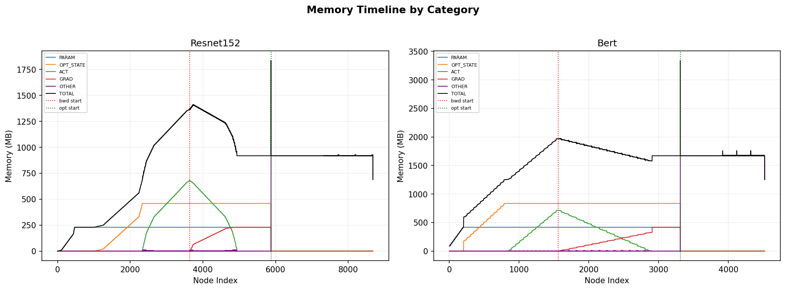
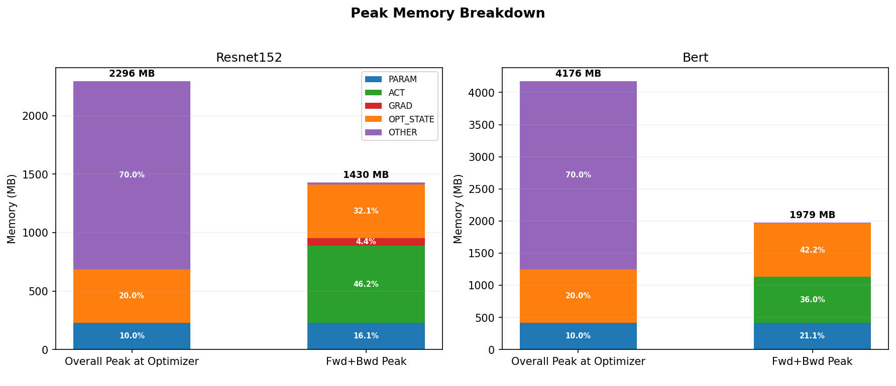
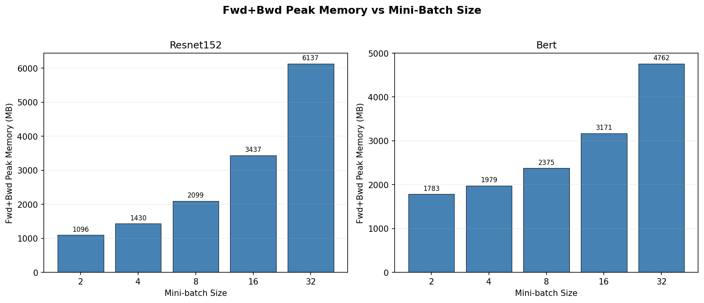

# Activation Checkpointing Phase 1

**Chong Zhao**

## 1. Introduction

This project builds a computation graph profiler for PyTorch that captures a full training iteration within a single traced graph. 
The profiler executes the graph node by node, recording per-operator computation time and memory usage. It also classifies each 
node as a parameter, gradient, activation, optimizer state, or other. In addition, I perform static analysis on activations to 
document when each activation is created, its last use in the forward pass, and its first and last use in the backward pass for 
later activation checkpointing. I also evaluate the profiler on ResNet-152 and BERT-base, both with a batch size of 4 and generate 
a peak memory breakdown and show some cases of the lifetime of the activation. In addition, I also vary the batchsize to demonstrate 
that peak memory scales linearly with batch size.

## 2. Problems Tackled

**Graph Tracing and Region Partitioning:** Using PyTorch tracing, obtaining a full view of all operations in the computation graph for profiling. Based on special indicators, I partition the graph into forward, backward, and optimizer regions.

**Node Classification:** Classifying each node in the graph as PARAM, GRAD, ACT, OPT_STATE, or OTHER, and also record which region it belongs to.

**Operator Profiling:** Measuring the computation time and memory delta of each operator to see the distribution of computation and memory costs.

**Activation Lifetime:** Tracking activations produced in the forward pass and later used in the backward pass. For each activation, I measures its idle time based on its first use and last use in forward and backward pass.

**Peak Memory Breakdown Analysis:** Simulating memory usage across the execution timeline and break down peak memory by category.

**Batch Size Scaling Analysis:** Measuring how peak memory grows with mini batchsize.

## 3. Technical Description

### 3.1 Graph Tracing and Region Partitioning

**Problem framing:** To profile a full training iteration, we need all operations to appear in one computation graph. Given the traced graph, we also further need to divide it into forward pass, backward pass, and optimizer step for later analysis.

**High-level solution:** The starter file provides a traced graph.I then use special identifier nodes in the traced graph to separate the cahin of operations into forward, backward, and optimizer regions.

**Deeper details:** The identifier nodes are identity-like ops registered with torch.library.Library in graph_tracer.py. Here, sep marks the end of the forward pass, and sep_backward marks the start of the backward pass. I scan the traced graph to locate these boundary nodes together with the _fused_adam optimizer node, then partition nodes by index into three groups. Nodes before sep are in the forward group, nodes between sep_backward and _fused_adam are in the backward group, and nodes from _fused_adam onward are in the optimizer group.

**Results:** The traced graphs and their region partitions are shown below.

| Region | ResNet-152 | BERT |
|-----------|-----------|------|
| Forward | 3,637 | 1,557 |
| Backward | 2,236 | 1,753 |
| Optimizer | 2,806 | 1,210 |
| Other | 3 | 3 |
| Total | 8,682 | 4,523 |

ResNet-152 has nearly twice as many nodes as BERT, with the forward region being the largest. In BERT, the backward region is slightly larger than the forward. The 3 other nodes in both models are bookkeeping nodes at the boundary.

### 3.2 Node Classification

**Problem framing:** The project let us to divide the nodes in to parameters, gradients, activations, optimizer states, and other, since the peak memory is made up of these component. 

**High-level solution:** I classify nodes using the argument structure of the optimizer node:

- args[0] corresponds to parameter nodes (PARAM)
- args[1] corresponds to gradient nodes (GRAD)
- args[2:] corresponds to opt state nodes (OPT STATE)
- Non-placeholder nodes in the forward region with at least one backward user are activation nodes (ACT)
- All remaining nodes are other. (OTHER)

**Deeper details:** For PARAM, GRAD, and OPT_STATE, I directly read them from the optimizer node arguments. For activations, I use the rules as mentioned in the insturction: a node is an ACT node if it lies in the forward region before sep, is not a placeholder, has not already been classified as PARAM, GRAD, or OPT_STATE, and is used by at least one node in the backward region. 

**Results:**

**Node Type Distribution:**

| Type | ResNet-152 | BERT |
|-----------|-----------|------|
| PARAM | 467 (5.4%) | 201 (4.4%) |
| ACT | 778 (9.0%) | 362 (8.0%) |
| GRAD | 467 (5.4%) | 201 (4.4%) |
| OPT_STATE | 1,401 (16.1%) | 603 (13.3%) |
| OTHER | 5,569 (64.1%) | 3,156 (69.8%) |
| Total | 8,682 | 4,523 |

In both models, the number of PARAM nodes matches the number of GRAD nodes,  since each parameter produces one gradient. The OTHER category is the largest, making up over 60% of all nodes in both models. These are mostly intermediate computation nodes, so they are temporary and do not persist across regions.

### 3.3 Per-Operator Runtime and Memory Profiling

**Problem framing:** The project requires to record the runtime and memory for each operation, since we need the execution time and memory effect of each operation. 

**High-level solution:** The initial setting of the codebase runs 2 warmup iterations first, then calls reset_stats, runs 3 measurement iterations, and finally calls aggregate_stats and print_stats. I implement run_node to measure each node with CUDA events for runtime and torch.cuda.memory_allocated for memory usage. I also implement reset_stats to clear profiling results without affecting the static analysis, and aggregate_stats to average the measurements across runs.

**Deeper details:** For runtime measurement, run_node creates a pair of CUDA events and records a start event before executing the node and an end event after. I then call torch.cuda.synchronize to ensure the GPU operation has completed, and compute the elapsed time, which is appended to a list for each node across profiling iterations. For memory measurement, the function call torch.cuda.memory_allocated before and after executing the node, 
and the difference gives the memory delta for that node. The output size is computed once per node by the _tensor_bytes helper. For activation nodes, this output size is also stored in the activation lifetime record. Finally, aggregate_stats averages all per-node runtime and memory delta measurements across the profiling iterations to produce avg_ms and avg_mem_delta.

**Results:** 

**Computation Time by Region:**

| Region | ResNet-152 (ms) | % | BERT (ms) | % |
|-----------|----------------|------|-----------|------|
| Forward | 151.94 | 33.9% | 72.68 | 28.1% |
| Backward | 138.79 | 31.0% | 120.85 | 46.7% |
| Optimizer | 156.97 | 35.0% | 64.68 | 25.0% |
| Total | 448.29 | | 258.55 | |

**Net Memory Delta by Region (MB):**

| Region | ResNet-152 | BERT |
|-----------|-----------|------|
| Forward | +707.21 | +428.75 |
| Backward | +1,493.00 | +1,275.40 |
| Optimizer | +937.36 | +1,672.91 |

For ResNet-152, the runtime is split fairly evenly across forward, backward, and optimizer regions. For BERT, the backward region dominates, taking 47.7% of the total time. In both models, the backward pass and optimizer have large positive memory delta.

### 3.4 Activation Lifetime Analysis

**Problem framing:** In this section, we need to track the activation lifetime to facilitate the implmentation for later activation checkpointing, since activation checkpointing saves memory by dropping activations in the forward pass and recomputing them later in the backward pass. To decide which activations are worth checkpointing, we need to know how long they are idle in memory.

**High-level solution:** For each activation, I record four indices:

- first_fwd_use_idx: the node index where the activation is produced in the forward pass
- last_fwd_use_idx: the last forward-pass node that uses it
- first_bwd_use_idx: the first backward-pass node that uses it
- last_bwd_use_idx: the last backward-pass node that uses it

From these, we compute idle_steps, which measures how long the activation is unused in memory after its last forward use and before its first backward use. The last_bwd_use_idx tells us when the activation is no longer needed and can be freed.

**Deeper details:** We go through all activation nodes and inspect their users. We take the maximum index among forward users as last_fwd_use_idx, and the minimum and maximum indices among backward users as first_bwd_use_idx and last_bwd_use_idx. If there is no forward user after the activation is created, we use first_fwd_use_idx  as last_fwd_use_idx. I store this as a dictionary and leave the size_bytes field empty at first, filling it later during profiling when run_node computes the output tensor size.

**Results:**

ResNet-152 has 778 activations and BERT has 362 activations. The top 5 activations by size for each model are shown below.

**ResNet-152**

| Name | Size (MB) | Producer | Last Fwd Use | First Bwd Use | Idle Steps |
|------|-----------|----------|-------------|--------------|------------|
| relu__3 | 12.25 | 2,379 | 2,403 | 4,896 | 2,493 |
| convolution | 12.25 | 2,337 | 2,339 | 4,934 | 2,595 |
| relu__6 | 12.25 | 2,404 | 2,428 | 4,871 | 2,443 |
| convolution_3 | 12.25 | 2,364 | 2,366 | 4,908 | 2,542 |
| relu__9 | 12.25 | 2,429 | 2,453 | 4,823 | 2,370 |

**BERT**

| Name | Size (MB) | Producer | Last Fwd Use | First Bwd Use | Idle Steps |
|------|-----------|----------|-------------|--------------|------------|
| t_10 | 9.00 | 947 | 948 | 2,699 | 1,751 |
| t_22 | 9.00 | 1,063 | 1,064 | 2,481 | 1,417 |
| t_40 | 9.00 | 1,237 | 1,238 | 2,154 | 916 |
| t_47 | 9.00 | 1,300 | 1,301 | 2,034 | 733 |
| t_52 | 9.00 | 1,353 | 1,354 | 1,936 | 582 |

In ResNet-152, the largest activations are mostly ReLU outputs and convolution feature maps, and they tend to have long idle times. In BERT, the largest activations are mainly transposed weight matrices, but they have much shorter idle times.

### 3.5 Peak Memory Simulation

**Problem framing:** To understand how much memory activation checkpointing can actually save, we need to know exactly what the memory is made of at the peak point.

**High-level solution:** In aggregate_stats, I try to simulate the memory usage of every node's output tensor over all execution steps. For each node, its output is alive from its own index until the index of its last user, which is determined by the node.users field. Each node is then assigned to one of five categories of node type. At each step, the total live memory is the sum of all five categories. I track two peaks: the overall peak  and the forward+backward peak, since I realized that the overall peak is during the optimizer step, but activation checkpointing targets the memory in the forward or backward pass .

**Deeper details:** For each node, I compute its lifetime as the range from its own index to the maximum index among its users. 
If a node has no users, it is alive only at its own step. The forward+backward peak is computed separately as the maximum total 
memory usage before the optimizer node index.

**Results:**

The overall peak is at the optimizer, since one operator in optimizer step outputs all updated parameters and optimizer states as one large tuple. The OTHER category dominates the overall peak because it includes this optimizer output. At the forward+backward pass peak, activations are the dominant component of the memory, making up 46.2% for ResNet-152 and 36.0% for BERT. 

### 3.6 Batch Size Scaling Analysis

**Problem framing:** We want to see how peak memory grow with mini batchsize grow during training generally. If the growth is substantial, then activation checkpointing can provide more benefit.

**High-level solution:** We run the profiler over a range of batch sizes for each model. For each batch size, we trace and compile the training step, run the profiler, and then read the forward+backward peak memory from the output file. We report the forward+backward peak rather than the overall peak, since the overall peak is dominated by the optimizer's output tuple and is not affected by activation checkpointing.

**Deeper details:** For ResNet-152, we try batch sizes [2, 4, 8, 16, 32], and for BERT, [2, 4, 8, 16, 32]. Before and after each run, we call torch.cuda.empty_cache() to keep the memory state cleaner across experiments. We read the forward+backward peak memory for each batch size from the CSV written by print_stats.

**Results:**

Forward+backward peak memory increases roughly linearly with batch size for both models. ResNet-152 grows from 1,096 MB at batch size 2 to 6,137 MB at batch size 32, while BERT grows from 1,783 MB at batch size 2 to 4,762 MB at batch size 32. The trend is not perfectly linear because parameters and optimizer states are fixed overhead, and activations scale with batch size.

## 4. Challenges

- **Overall peak at the optimizer:** When having the peak at optimizer step,  it took me a while to realize what is going on, since ideally the peak should happen during the forward or backward pass.  After searching, I realized that _fused_adam outputs all updated params and opt_states as one large tuple. This output temporarily exists together with the old nodes,  increasing their memory.  Since for activation checkpointing, we focus more on the forward and backward pass, I just report the forward+backward peak separately.

- **Optimizer variant mismatch:** The provided starter_code.py originally used foreach=True for the Adam optimizer.  However, the boundary detection in graph_prof.py searches for _fused_adam to identify the optimizer region. The profiler initially failed to find the optimizer node and crashed. I then switched to fused=True so the traced graph contains _fused_adam as expected. 

- **BERT tracing compatibility:** The pytorch does not have on-the-shelf BERT model. So, I use HuggingFace's BertForSequenceClassification. But it returns output, which the tracing cannot handle. So, I had to set return_dict=False, so the model returns a plain tuple that FX can trace through. 

  
